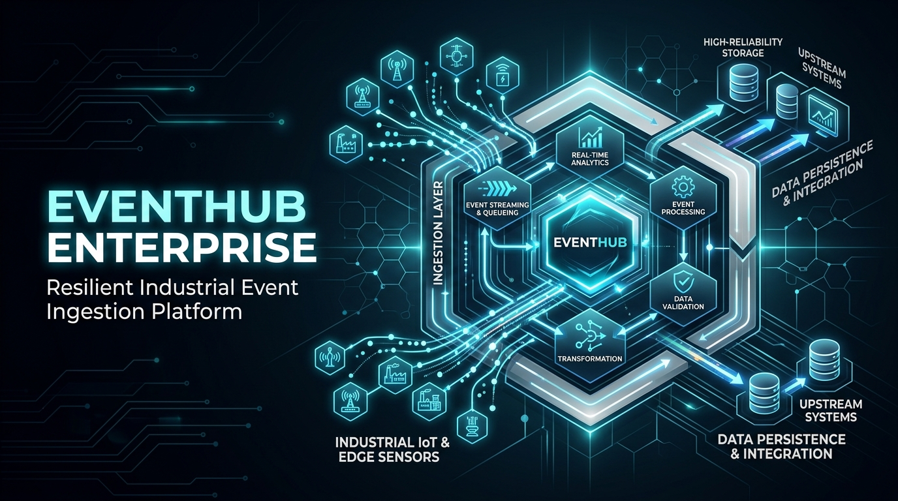
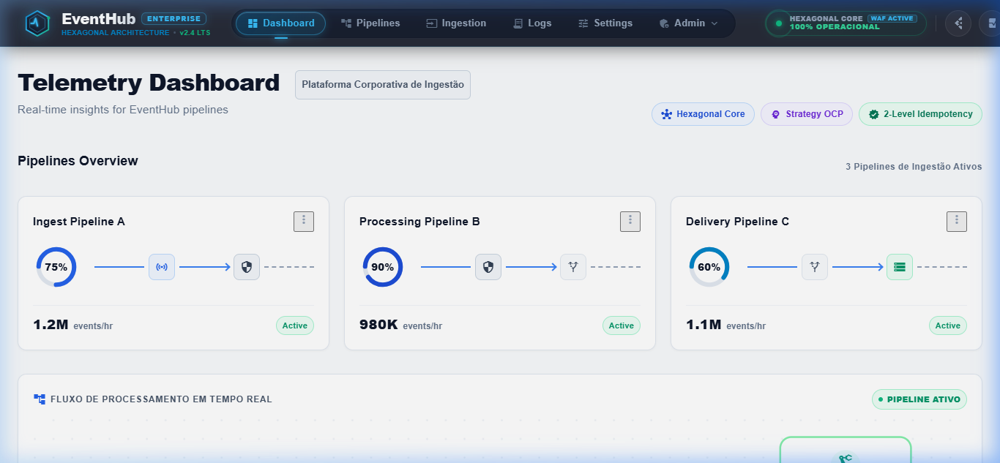
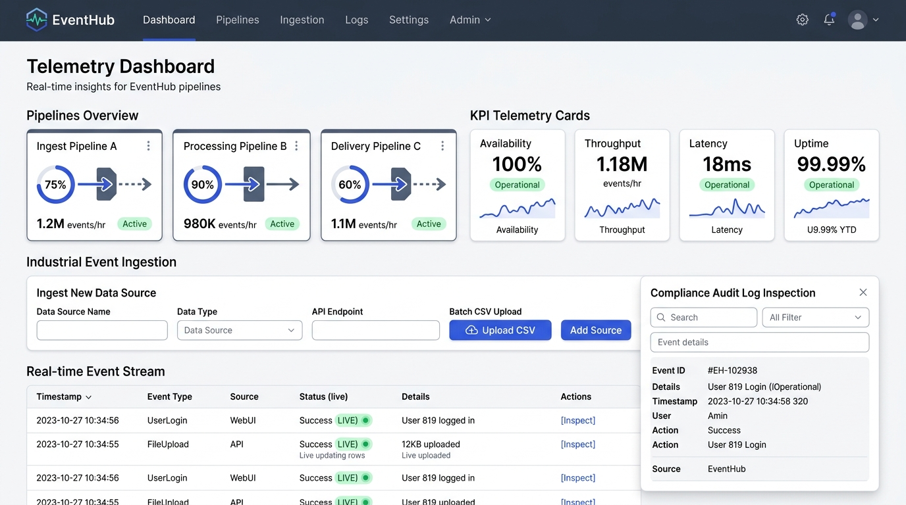
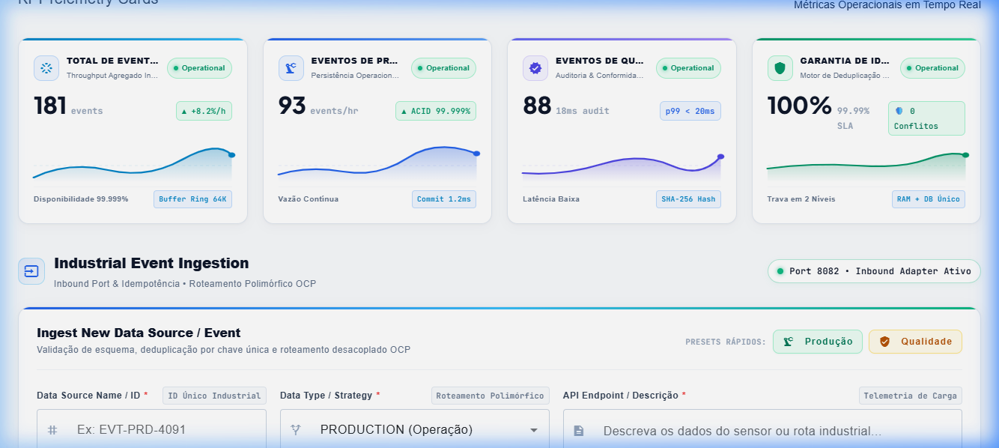
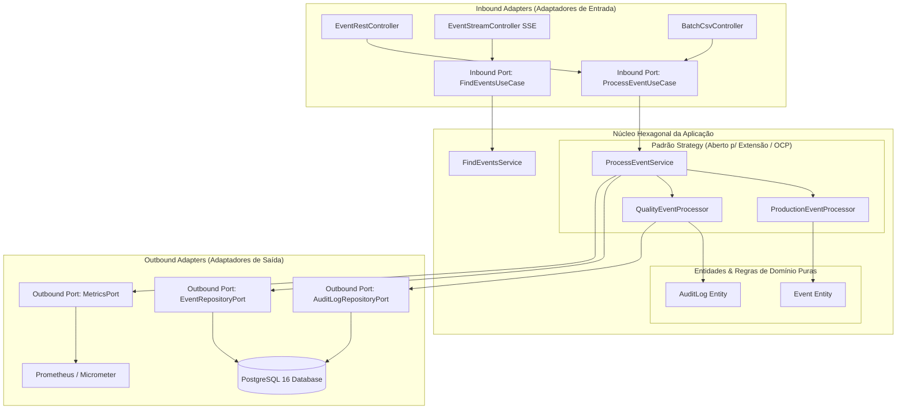
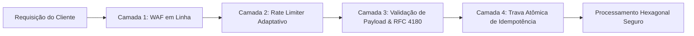
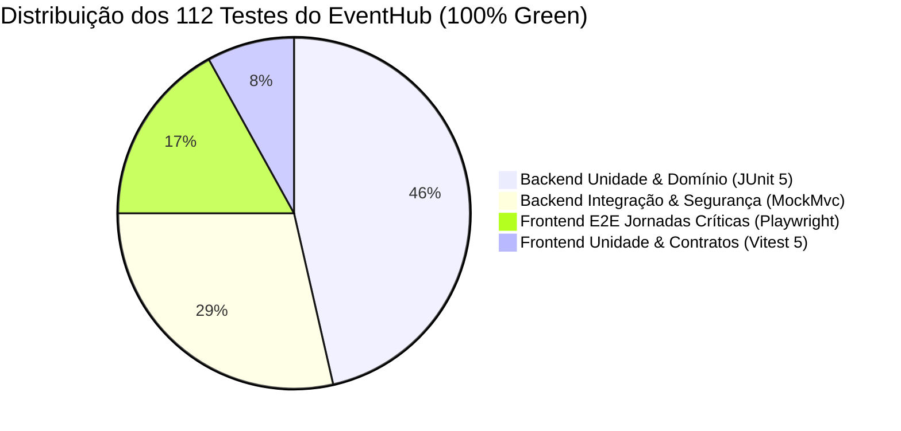

# EventHub Enterprise — Plataforma de Ingestão & Telemetria Industrial

<p align="center">
  
</p>

<p align="center">
  <a href="https://github.com/cypheriantechnology-innovation/eventhub"></a>
  <a href="https://spring.io/projects/spring-boot"></a>
  <a href="https://www.oracle.com/java/"></a>
  <a href="https://angular.dev"></a>
  <a href="https://vitest.dev"></a>
  <a href="https://playwright.dev/"></a>
  <a href="https://www.postgresql.org/"></a>
  <a href="https://www.docker.com/"></a>
  <a href="#"></a>
</p>

---

## 📑 Sumário

### 🧭 Parte 1: Para Qualquer Pessoa (Mesmo Sem Conhecimento Técnico)
1. [O Que é o EventHub em 1 Minuto?](#-1-o-que-é-o-eventhub-em-1-minuto)
2. [A Analogia do Mundo Real: A Torre de Controle da Fábrica](#-2-a-analogia-do-mundo-real-a-torre-de-controle-da-fábrica)
3. [Que Problema Ele Resolve? (O Antes vs O Depois)](#-3-que-problema-ele-resolve-o-antes-vs-o-depois)
4. [Um Dia Típico na Fábrica com o EventHub (Historinha Prática)](#-4-um-dia-típico-na-fábrica-com-o-eventhub-historinha-prática)
5. [Dicionário Amigável: Traduzindo o "Technês" para o Português](#-5-dicionário-amigável-traduzindo-o-technês-para-o-português)
6. [Tour Visual pelas Telas: O Que Você Vê na Prática](#-6-tour-visual-pelas-telas-o-que-você-vê-na-prática)

### ⚡ Parte 2: Experimentação Imediata
7. [Como Rodar o Sistema em 2 Minutos (Com Docker)](#-7-como-rodar-o-sistema-em-2-minutos-com-docker)
8. [Como Testar e Usar na Tela (Passo a Passo)](#-8-como-testar-e-usar-na-tela-passo-a-passo)

### 🏛️ Parte 3: Engenharia Profunda (Para Desenvolvedores & Arquitetos)
9. [Arquitetura Hexagonal (Ports & Adapters) & Princípio OCP](#-9-arquitetura-hexagonal-ports--adapters--princípio-ocp)
10. [Segurança Cibernética & Defesa em Profundidade (DevSecOps)](#-10-segurança-cibernética--defesa-em-profundidade-devsecops)
11. [Pirâmide Completa de 112 Testes Automatizados](#-11-pirâmide-completa-de-112-testes-automatizados)
12. [Especificação Completa da API REST](#-12-especificação-completa-da-api-rest)
13. [Observabilidade, Métricas Prometheus & Rastreabilidade](#-13-observabilidade-métricas-prometheus--rastreabilidade)
14. [Estrutura do Repositório & Licença](#-14-estrutura-do-repositório--licença)

---

# 🧭 Parte 1: Para Qualquer Pessoa

## 💡 1. O Que é o EventHub em 1 Minuto?

O **EventHub** é o **cérebro digital e o maestro de uma indústria moderna**.

Em fábricas de automóveis, farmacêuticas, cervejarias ou usinas de energia, milhares de máquinas, esteiras, robôs e sensores estão trabalhando dia e noite. A cada fração de segundo, essas máquinas produzem informações valiosas: *"uma peça foi montada"*, *"a temperatura do forno subiu"*, *"uma garrafa de xarope saiu com o lacre imperfeito"*.

O papel do **EventHub** é:
1. **Ouvir tudo** o que as máquinas dizem, mesmo em redes de internet instáveis de fábrica.
2. **Garantir que nada seja contado duas vezes** (se um sensor falhar e mandar a mesma peça 5 vezes, o sistema conta apenas 1 vez).
3. **Encaminhar cada aviso para o lugar certo**: se for produção normal, soma nos gráficos; se for um defeito de qualidade, gera um registro de auditoria lacrado que ninguém pode apagar nem falsificar.
4. **Fazer a tela do computador piscar na hora** com os novos dados, sem que o operador precise ficar apertando "F5" para atualizar.
5. **Proteger a fábrica contra ataques e invasões**, bloqueando hackers que tentem enviar dados falsos para desregular as máquinas.

---

## 🛫 2. A Analogia do Mundo Real: A Torre de Controle da Fábrica

Para entender com clareza, imagine um **aeroporto internacional super movimentado**:

```
                       ✈️ Avião A (Voo Normal)
                            │
                            ▼
      ┌───────────────────────────────────────────────────┐
      │         TORRE DE CONTROLE (O EventHub)            │
      │  • Identifica o voo pelo prefixo único             │
      │  • Impede que 2 aviões pousem na mesma pista      │
      │  • Separa voos de passageiros de emergências      │
      └───────────────────────────────────────────────────┘
               │                                   │
               ▼                                   ▼
       Pista Normal (PRODUÇÃO)          Pista de Emergência (QUALIDADE)
    (Soma nos relatórios do dia)       (Trilha de Auditoria Inviolável)
```

- Cada máquina ou sensor é como um avião que quer pousar uma informação na tela do gerente.
- Sem uma **Torre de Controle**, haveria acidentes: dois aviões tentariam pousar na mesma pista ao mesmo tempo, mensagens se perderiam e ninguém saberia exatamente o que aconteceu.
- O **EventHub é a Torre de Controle**: ele confere o crachá de cada dado, garante pouso seguro, despacha para a pista correta e avisa a equipe no exato instante em que o trem de pouso toca o solo.

---

## ⚖️ 3. Que Problema Ele Resolve? (O Antes vs O Depois)

| Situação Cotidiana na Fábrica | Sem o EventHub (O Caos) ❌ | Com o EventHub (A Tranquilidade) ✅ |
| :--- | :--- | :--- |
| **Wi-Fi da fábrica oscila ou cai** | O sensor tenta reenviar a mesma peça 4 vezes. O sistema conta 4 peças a mais, bagunçando o estoque e gerando prejuízo financeiro. | O sistema reconhece o código único da peça e descarta as repetições automaticamente (**Garantia de Zero Duplicatas**). |
| **Auditoria Sanitária ou Fiscal (ISO / ANVISA)** | Auditores pedem o histórico de um lote contaminado. Encontram papéis perdidos ou planilhas de Excel que qualquer pessoa pode adulterar. | O sistema gera um **registro digital lacrado e imutável** gravado segundo a segundo com carimbo criptográfico. |
| **Acompanhamento da Produção** | O gerente precisa ligar no rádio da fábrica ou esperar o relatório no final do dia para saber se a meta foi batida. | O painel na tela **pisca em tempo real**. Uma peça passou na esteira há 10 milissegundos? O número na tela já subiu. |
| **Tentativa de Invasão ou Sabotagem** | Um invasor manda comandos maliciosos pela rede para travar as esteiras ou apagar o banco de dados. | O **Escudo de Segurança (WAF)** identifica a tentativa na porta de entrada e bloqueia o agressor na hora com código de incidente. |

---

## 🏭 4. Um Dia Típico na Fábrica com o EventHub (Historinha Prática)

Vamos acompanhar a história de uma garrafa de refrigerante na fábrica:

1. **A Garrafa Passa na Esteira**:
   - Um leitor a laser lê a garrafa e envia o código `EVT-PRD-4091`.
2. **A Portaria do EventHub**:
   - O sistema recebe a mensagem e pergunta ao banco de dados: *"Esse código `EVT-PRD-4091` já foi lido antes?"*
   - O banco responde: *"Não, é a primeira vez!"*. A garrafa é aceita.
3. **A Divisão das Águas**:
   - Se o sensor avisou que o envase ocorreu com perfeição, a garrafa vai para o pote de **PRODUÇÃO**. O contador de garrafas por hora sobe de 92 para 93.
   - Se o sensor óptico detectou que o rótulo ficou torto, a garrafa vai para a esteira de descarte e o EventHub ativa a rota de **QUALIDADE**: é gerado um carimbo permanente na lista de auditoria com a data, o segundo e o motivo da rejeição.
4. **O Supervisor Vê na Hora**:
   - Na sala de controle com ar-condicionado, a tela do computador do supervisor se atualiza sozinha, o gráfico desenha a nova curva e o indicador de segurança confirma: **100% de precisão**.

---

## 📖 5. Dicionário Amigável: Traduzindo o "Technês" para o Português

Não se assuste com os termos técnicos dos programadores. Veja o que eles realmente significam:

- **Idempotência**:
  > *É a garantia de que apertar o botão duas vezes não vai te cobrar duas vezes.* Se a maquininha de cartão travar e você passar o cartão de novo, o banco sabe que é a mesma compra e só debita uma vez. No EventHub, o sensor pode mandar a mesma peça 10 vezes que o sistema só registra uma.
- **Streaming Reativo / SSE (Server-Sent Events)**:
  > *É como as mensagens do WhatsApp chegando no seu celular na mesma hora.* Você não precisa ficar fechando e abrindo o aplicativo para ver se alguém respondeu. A tela do EventHub se atualiza sozinha, em tempo real.
- **Arquitetura Hexagonal**:
  > *É construir o sistema em blocos de Lego perfeitamente encaixáveis.* Se amanhã a fábrica quiser trocar o banco de dados da Oracle pelo da Microsoft, as regras de negócio da fábrica não quebram, porque estão protegidas em um núcleo blindado.
- **WAF (Web Application Firewall)**:
  > *É o segurança de terno preto na portaria da fábrica.* Ele abre a mala de todo mundo que quer entrar. Se alguém estiver carregando algo perigoso (como comandos que tentam invadir o sistema), o segurança barra na hora e não deixa nem chegar perto das máquinas.
- **RFC 4180**:
  > *A regra oficial do mundo para ler planilhas CSV.* Se você salvar um texto com vírgulas ou aspas (ex: `"Sensor de esteira, calibrado no setor B"`), o sistema não vai se confundir achando que a vírgula é uma nova coluna.

---

## 🖥️ 6. Tour Visual pelas Telas: O Que Você Vê na Prática

A interface do EventHub foi desenhada no padrão visual **Executive Light Mode** (usado pelas maiores empresas de tecnologia do mundo como Datadog, Stripe e AWS), elegante, moderna e muito fácil de navegar:

### 1. Central de Comando Superior (Executive Navigation Bar)
Na parte superior da tela, uma barra de comando translúcida e escura abriga o logo hexagonal com batimentos cardíacos da fábrica em tempo real (ECG), o radar de segurança DevSecOps ativo e as abas para alternar entre as visões do sistema:

<p align="center">
  
</p>

### 2. Painel de Produção & Velocímetros das Linhas (Overview)
Três cartões mostram os velocímetros em anel (gauges circulares) com a ocupação de cada setor da fábrica (Linha de Montagem A em 75%, Célula Robótica B em 90%, Inspeção Final C em 60%) e a vazão em milhões de eventos por hora:

<p align="center">
  
</p>

### 3. Os 4 Indicadores Executivos (KPIs com Gráficos Sparkline)
Logo abaixo do painel, quatro cartões analíticos exibem:
- **Total de Eventos Ingeridos**: Quantas peças ou leituras a fábrica já processou no dia.
- **Eventos de Produção (PRD)**: O ritmo da fabricação normal com garantia de persistência sólida.
- **Eventos de Qualidade (QLT)**: As auditorias e conformidades com latência ultrarrápida (menos de 20 milissegundos).
- **Garantia de Idempotência**: O selo de **100% de precisão**, provando quantas duplicatas foram interceptadas e descartadas antes de poluir os números.

### 4. O Novo Portal de Ingestão em 2 Camadas (Industrial Event Ingestion)
Um formulário espaçoso, elegante e sem textos cortados:
- **Camada 1 (Campos)**: Espaço generoso para digitar o Código da Peça (`Data Source Name / ID`), escolher o Tipo de Operação (`PRODUCTION` ou `QUALITY`) e descrever o sensor com altura uniforme e sem caixas de texto quebradas.
- **Camada 2 (Controles & Ações)**: À esquerda, exibe ao vivo qual regra do sistema foi ativada e o cadeado verde de proteção de duplicatas; à direita, dois botões elegantes: **Upload CSV** (para carregar planilhas inteiras de uma vez) e **+ Add Source** (para enviar o dado imediatamente).

<p align="center">
  
</p>

### 5. A Tabela ao Vivo (Real-time Event Stream)
Uma lista que recebe novos eventos automaticamente via streaming. Quando uma nova leitura entra, uma linha verde pisca com a data, hora exata e botão `[Auditoria]` para inspecionar o histórico.

### 6. A Janela de Auditoria e Conformidade Legal
Clicando no botão de auditoria em um evento de qualidade, abre-se uma janela flutuante com o **histórico inviolável**: a data exata em milissegundos, a ação registrada e o carimbo de conformidade exigido por leis industriais e sanitárias.

---

# ⚡ Parte 2: Experimentação Imediata

## 🚀 7. Como Rodar o Sistema em 2 Minutos (Com Docker)

Você não precisa instalar Java, Node.js nem banco de dados na sua máquina. Se você tem o **Docker Desktop** instalado, basta 1 comando:

```bash
# 1. Clone o repositório
git clone https://github.com/cypheriantechnology-innovation/eventhub.git
cd eventhub

# 2. Suba todos os containers (Banco de Dados + Servidor + Telas)
docker compose up -d --build
```

Em poucos instantes, três serviços estarão rodando de forma orquestrada e saudável:
- 🌐 **Interface Web (Frontend)**: Acesse no seu navegador em [http://localhost:4200](http://localhost:4200)
- ⚙️ **Servidor da API (Backend Spring Boot)**: Rodando em [http://localhost:8082](http://localhost:8082)
- 🗄️ **Banco Relacional (PostgreSQL 16)**: Porta 5432 gerenciando os dados industriais com integridade ACID.

---

## 🎮 8. Como Testar e Usar na Tela (Passo a Passo)

1. Abra [http://localhost:4200](http://localhost:4200) no seu navegador.
2. Na seção **Industrial Event Ingestion**:
   - Clique no botão rápido **`Produção`**: os campos serão preenchidos automaticamente com uma simulação de esteira de fábrica.
   - Clique no botão azul **`+ Add Source`**: você verá uma mensagem de sucesso verde e o evento aparecerá instantaneamente na tabela abaixo.
3. Testando a **Proteção de Duplicatas (Idempotência)**:
   - Sem mudar nada no formulário, clique em **`+ Add Source`** novamente.
   - O sistema **rejeitará na hora**, exibindo um aviso de conflito dizendo que aquele código já foi registrado. O estoque não foi duplicado!
4. Testando a **Auditoria de Qualidade**:
   - Clique no botão rápido **`Qualidade`** e em seguida em **`+ Add Source`**.
   - Na tabela abaixo, localize a linha recém-criada e clique no botão **`Auditoria`**: uma janela exibirá a trilha imutável gerada pelo processador de conformidade.

---

# 🏛️ Parte 3: Engenharia Profunda

## 🏗️ 9. Arquitetura Hexagonal (Ports & Adapters) & Princípio OCP

O **EventHub** adota a **Arquitetura Hexagonal de Alistair Cockburn** combinada com **Domain-Driven Design (DDD)** e **Clean Architecture**:



### Princípio Aberto/Fechado (OCP — Open/Closed Principle)
A interface `EventProcessorStrategy` permite adicionar novos tipos de eventos industriais (ex: `MAINTENANCE`, `LOGISTICS`, `SAFETY`) sem tocar ou arriscar o código existente:
- `ProductionEventProcessor`: Focado em alta vazão e persistência transacional ACID.
- `QualityEventProcessor`: Focado em rastreabilidade imutável, gerando automaticamente registros em `audit_logs` com hash SHA-256.

---

## 🛡️ 10. Segurança Cibernética & Defesa em Profundidade (DevSecOps)

O sistema opera sob o modelo de **Defesa em Profundidade (Defense-in-Depth)** em 4 camadas ativas:



1. **Camada 1: Web Application Firewall (WAF) Nativo em Linha**:
   - `WafFilter` inspeciona URIs, query strings e bodies JSON antes de atingir qualquer controller.
   - Detecta e neutraliza ataques de **SQL Injection**, **Cross-Site Scripting (XSS)**, **Path Traversal (`../`)** e **Command Injection**, gerando um identificador único de incidente (`incidentId`) para perícia forense e retornando `HTTP 403 Forbidden`.
2. **Camada 2: Rate Limiter de Janela Deslizante (Sliding Window)**:
   - `SlidingWindowRateLimiter` em memória com limpeza automática de buckets. Bloqueia tentativas de negação de serviço (DoS) retornando `HTTP 429 Too Many Requests`.
3. **Camada 3: Sanitização de Arquivos & RFC 4180**:
   - Leitor CSV com suporte a campos entre aspas, vírgulas embutidas e quebras de linha perfeitamente balanceadas.
   - Verificação de cabeçalhos mágicos para rejeitar extensões camufladas (`.exe`, `.bat`, `.sh`).
4. **Camada 4: Trava em 2 Níveis contra Duplicatas**:
   - Nível 1: Verificação rápida em memória via `existsByEventId()` no repositório.
   - Nível 2: Restrição de chave primária física `UNIQUE (event_id)` no PostgreSQL, prevenindo condições de corrida (*race conditions*).

---

## 🧪 11. Pirâmide Completa de 112 Testes Automatizados

O ecossistema mantém **112 testes automatizados** com **100% de aprovação (Zero falhas, zero skips)**:



| Camada | Ferramenta | Quantidade | O que Valida? | Comando de Execução |
| :--- | :--- | :---: | :--- | :--- |
| **Backend Unit** | JUnit 5 / AssertJ | **52** | Regras de domínio, validadores de segurança, algoritmos de rate limit e estratégias OCP isoladas de banco. | `mvn test -Dtest=*UnitTest` |
| **Backend Integration** | Spring Boot / MockMvc | **32** | APIs REST completas, WAF em ação, persistência PostgreSQL, métricas Actuator e bloqueio de conta. | `mvn test -Dtest=*IntegrationTest` |
| **Frontend Unit & Contracts** | Vitest 5 | **9** | Serviços Angular com mock de HttpClient, propagação de erros 409 e validação de contratos de modelo TypeScript. | `npm test` (na pasta `frontend`) |
| **Frontend E2E** | Playwright / Chromium | **19** | Navegação real no navegador: formulário em 2 camadas, animações SVG, streaming SSE ao vivo, upload CSV e WAF. | `npm run test:e2e` (na pasta `frontend`) |
| **TOTAL CONSOLIDADO** | — | **112** | **Cobertura holística ponta a ponta (100% Green)** | — |

---

## 📡 12. Especificação Completa da API REST

Todas as respostas contêm o cabeçalho de rastreabilidade corporativa `X-Correlation-Id`.

| Método | Endpoint | Descrição | Payload / Parâmetros | Código Sucesso | Erros Possíveis |
| :--- | :--- | :--- | :--- | :---: | :---: |
| `POST` | `/api/events` | Ingestão atômica de novo evento industrial | `{ "eventId": "EVT-1", "eventType": "PRODUCTION", "description": "..." }` | `201 Created` | `400`, `403`, `409` |
| `GET` | `/api/events` | Listagem paginada e ordenada de eventos | `?page=0&size=10&sort=desc` | `200 OK` | `400` |
| `GET` | `/api/events/{id}` | Busca de evento por identificador único | Path parameter `{id}` | `200 OK` | `404` |
| `GET` | `/api/events/stats` | Contadores agregados instantâneos de telemetria | N/A | `200 OK` | `500` |
| `GET` | `/api/events/{id}/audit` | Trilha imutável de auditoria regulatória | Path parameter `{id}` | `200 OK` | `404` |
| `POST` | `/api/events/upload` | Ingestão em lote via arquivo CSV / JSON | `multipart/form-data` (arquivo `.csv`) | `200 OK` | `400`, `415` |
| `GET` | `/api/events/stream` | Canal de streaming de eventos em tempo real | Server-Sent Events (`text/event-stream`) | `200 OK` | `503` |

---

## 📊 13. Observabilidade, Métricas Prometheus & Rastreabilidade

O **EventHub** já vem preparado para dashboards corporativos do **Grafana** e sistemas de monitoramento como **Datadog** e **New Relic**:

- **Métricas Prometheus em Linha**: Disponíveis em `/actuator/prometheus` (protegidas por autenticação interna).
  - `eventhub_events_total{type="PRODUCTION"}`: Contador acumulado de peças produzidas.
  - `eventhub_events_total{type="QUALITY"}`: Contador acumulado de auditorias executadas.
  - `eventhub_duplicates_rejected_total`: Medidor de tentativas de reprocessamento bloqueadas pela idempotência.
- **Healthcheck & Status**: Disponível em `/actuator/health` com verificação de integridade do banco PostgreSQL.
- **Correlation ID (`X-Correlation-Id`)**: Cada requisição recebe ou preserva um UUID rastreável que atravessa todos os logs do frontend, do Nginx e do Spring Boot para investigação imediata de falhas.

---

## 📁 14. Estrutura do Repositório & Licença

```
EventHub/
├── backend/                       # Microsserviço Spring Boot 3.2 (Java 17)
│   ├── src/main/java/com/eventhub/
│   │   ├── domain/                # Entidades, Enums e Portas Hexagonais puras
│   │   ├── application/           # Casos de uso e estratégias OCP (Production/Quality)
│   │   └── infrastructure/        # Adaptadores Web REST, Persistência JPA e Filtros WAF
│   └── src/test/java/com/eventhub/# 84 Testes Automatizados (Unit, Integration, Security)
├── frontend/                      # Aplicação Web Angular 17.3 (Executive Theme)
│   ├── src/app/                   # Componentes, Serviços Reativos e Modelos de Domínio
│   ├── src/app/**/*.spec.ts       # 9 Testes Unitários e de Contrato (Vitest 5)
│   └── e2e/                       # 19 Testes End-to-End no Navegador (Playwright)
├── docs/images/                   # Ativos visuais e diagramas da plataforma
├── docker-compose.yml             # Orquestrador multi-container de infraestrutura
└── README.md                      # Documentação mestra do sistema
```

### 📄 Licença
Distribuído sob a licença **MIT**. Consulte o arquivo `LICENSE` para obter mais detalhes.

---

<p align="center">
  <strong>EventHub Enterprise</strong> • Projetado para Excelência Operacional, Resiliência Industrial e Clareza Absoluta.
</p>
