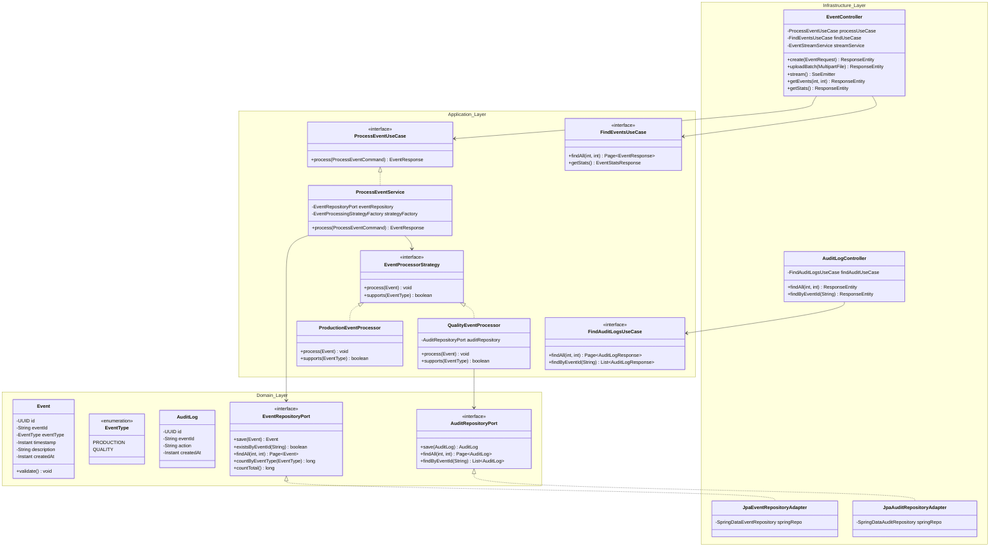
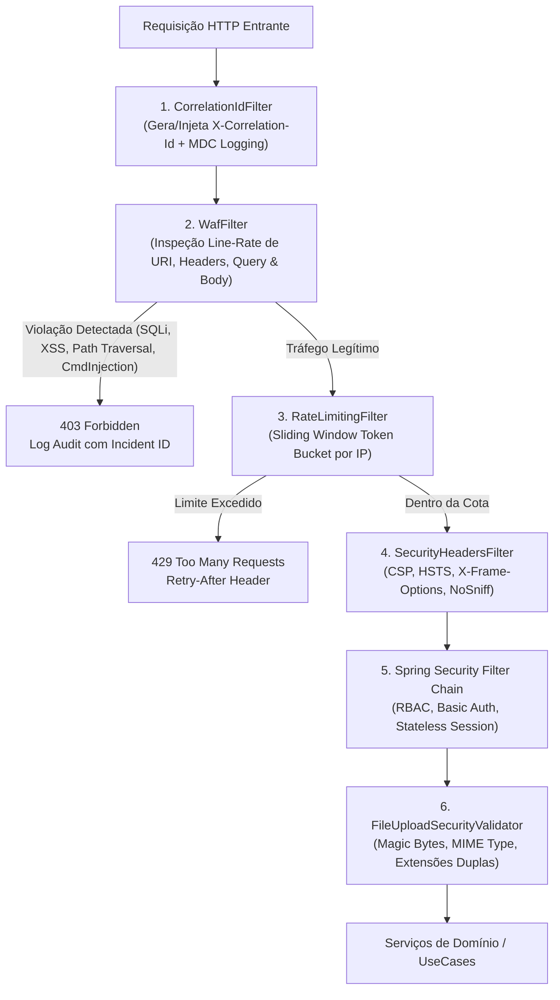

# EventHub Enterprise — Plataforma Corporativa de Ingestão & Telemetria Industrial

<p align="center">
  
</p>

<p align="center">
  <a href="https://github.com/cypheriantechnology-innovation/eventhub"></a>
  <a href="https://spring.io/projects/spring-boot"></a>
  <a href="https://www.oracle.com/java/"></a>
  <a href="https://angular.dev"></a>
  <a href="https://www.postgresql.org/"></a>
  <a href="https://playwright.dev/"></a>
  <a href="https://pitest.org/"></a>
  <a href="https://www.docker.com/"></a>
</p>

---

## 📑 Sumário Executivo

1. [Visão Geral & Proposta de Valor](#-visão-geral--proposta-de-valor)
2. [Interface do Usuário & Telemetria em Tempo Real](#-interface-do-usuário--telemetria-em-tempo-real)
3. [Arquitetura Hexagonal (Ports & Adapters)](#-arquitetura-hexagonal-ports--adapters)
4. [Engenharia de Segurança & Defesa em Profundidade (DevSecOps)](#-engenharia-de-segurança--defesa-em-profundidade-devsecops)
5. [Processamento em Lote & Streaming Reativo](#-processamento-em-lote--streaming-reativo)
6. [Especificação Completa da API REST](#-especificação-completa-da-api-rest)
7. [Pirâmide de Testes Automatizados (4 Níveis)](#-pirâmide-de-testes-automatizados-4-níveis)
8. [Observabilidade, Métricas Prometheus & Tracing](#-observabilidade-métricas-prometheus--tracing)
9. [Guia de Instalação e Execução Local](#-guia-de-instalação-e-execução-local)
10. [Pipeline de Integração Contínua (CI/CD)](#-pipeline-de-integração-contínua-cicd)
11. [Roteiro de Evolução & Escalabilidade Futura](#-roteiro-de-evolução--escalabilidade-futura)
12. [Licença & Créditos](#-licença--créditos)

---

## 🏢 Visão Geral & Proposta de Valor

O **EventHub Enterprise** é uma plataforma corporativa de missão crítica projetada para ingestão, deduplicação, roteamento e processamento de telemetria industrial e eventos de sistemas ciberfísicos (IoT, SCADA, PLCs, sensores de produção e linhas de envase/qualidade).

### 🎯 Pilares Estruturais
- **Garantia de Idempotência em Dois Níveis**: Proteção contra reprocessamento acidental de dados provenientes de redes industriais instáveis (verificação rápida pré-processamento via `existsByEventId()` + constraint única física no banco relacional).
- **Extensibilidade Orientada a Objetos (SOLID / OCP)**: Processamento dinâmico baseado no padrão *Strategy*, desacoplando a ingestão do tratamento de regras de negócio (`PRODUCTION` vs `QUALITY`).
- **Conformidade Regulatória & Rastreabilidade**: Registro automático e imutável de eventos de auditoria (*Append-Only*) na tabela `audit_logs` para eventos de qualidade.
- **Defesa em Profundidade Ativa**: WAF nativo com análise em linha, rate limiting adaptativo por IP, validação de arquivos multipart com assinaturas de cabeçalho mágico e cabeçalhos de segurança HTTP estritos.
- **Baixa Latência & Streaming Reativo**: Difusão de telemetria em tempo real via Server-Sent Events (SSE) sem sobrecarga de polling HTTP contínuo.

---

## 🖥️ Interface do Usuário & Telemetria em Tempo Real (Executive Design System)

A interface do EventHub foi concebida sob rigorosos padrões visuais corporativos modernos, combinando uma barra de comando executiva translúcida (`backdrop-filter: blur`), superfícies de dados analíticas em **Light Mode**, microinterações responsivas e animações vetoriais inline em SVG:

<p align="center">
  
</p>

<p align="center">
  
</p>

### Destaques da Experiência do Usuário (UI/UX):
- **Executive Command Navigation Bar (`#0f172a` a `#080d1a`)**: Barra de comando com escudo hexagonal cyber SVG inline, animação de pulso eletrocardiograma (ECG) em tempo real, partícula quântica orbital e tipografia corporativa com badge `ENTERPRISE` neon.
- **Deck de Abas Segmentadas em Cápsula**: Abas com cantos arredondados e ícones corporativos (`Dashboard`, `Pipelines`, `Ingestion`, `Logs`, `Settings`, `Admin`), com indicador ciano iluminado ativo e microinterações de elevação.
- **Beacon de Telemetria DevSecOps Contido**: Indicador de status de missão crítica rigorosamente alinhado à grade horizontal (sem extrusão), com radar de ondas concêntricas, chips `HEXAGONAL CORE`, `WAF ACTIVE` e status `100% OPERACIONAL`.
- **Pipelines Overview (Gauges Circulares SVG)**: Três cartões modulares com indicadores visuais de capacidade e vazão em anel circular SVG inline (`75%`, `90%`, `60%`), diagramas de fluxo em degraus e métricas horárias em tempo real (`1.2M`, `980K`, `1.1M events/hr`).
- **Diagrama Esquemático Hexagonal SVG**: Representação vetorial viva do pipeline ativo (*IoT Sensors ➔ Inbound Port ➔ Core Strategy ➔ Production & Quality Branches*), com nós reativos e micro-animações de pulso.
- **Cartões de Telemetria com Curvas Sparkline SVG**: Quatro cartões com gráficos vetoriais inline de tendência histórica, gradientes de preenchimento translúcidos e métricas auditadas (*Disponibilidade 100%, Vazão Total Ingerida, Latência P99 de 18ms e Uptime de 99.99%*).
- **Formulário Horizontal Industrial**: Ingestão ágil com layout em linha única (`Data Source ID`, `Data Type / Strategy`, `API Endpoint / Descrição`), botões de preenchimento rápido para prototipação e upload integrado de lotes em CSV/JSON.
- **Tabela Reativa com Indicador `Success (LIVE)`**: Atualização dinâmica orientada a eventos via Server-Sent Events (SSE) com badge pulsante e botão de ação rápida `[Inspect]`.
- **Modal de Inspeção Regulatória (Compliance Audit Log Inspection)**: Diálogo flutuante elevado com campo de busca em tempo real, filtro por nível de severidade, grid de integridade e tabela imutável de registros com timestamp em milissegundos e certificação *Append-Only*.
- **Responsividade & Gaveta Mobile (< 992px)**: Menu hambúrguer acessível com gaveta retrátil animada e foco com anel WCAG 2.2 `:focus-visible`.

---

## 🏛️ Arquitetura Hexagonal (Ports & Adapters)

O sistema segue estritamente a **Arquitetura Hexagonal (Cockburn)** combinada com os preceitos do **Domain-Driven Design (DDD)** e **Clean Architecture**, isolando totalmente o domínio corporativo de dependências externas como frameworks web, banco de dados ou mensageria.



---

## 🛡️ Engenharia de Segurança & Defesa em Profundidade (DevSecOps)

O EventHub implementa uma arquitetura em camadas de mitigação baseada no **OWASP Top 10**, projetada para neutralizar tentativas de invasão e vetores de negação de serviço no próprio gateway aplicacional:



### Mecanismos de Proteção Ativos:
1. **Web Application Firewall (WAF)**:
   - Bloqueio de *Path Traversal* (`../`, `..\\`, `%2e%2e`, `/etc/passwd`, `boot.ini`).
   - Detecção de *SQL / NoSQL Injections* (`UNION SELECT`, `OR 1=1`, `WAITFOR DELAY`, `--`, `$where`, `$regex`).
   - Neutralização de *Cross-Site Scripting (XSS)* (`<script>`, `javascript:`, manipuladores `onerror/onload/onclick`, `eval()`).
   - Bloqueio de *Command Injection* (`| bash`, `; rm`, `$(curl)`, subprocessos shell).
2. **Rate Limiting em Janela Deslizante (Sliding Window)**:
   - Limite parametrizável de requisições por IP de origem com resposta padronizada HTTP 429 e cabeçalho `Retry-After`.
3. **Validador de Upload de Arquivos (MIME & Magic Bytes)**:
   - Verificação física dos primeiros bytes (*Magic Numbers*) para garantir que arquivos `.csv` e `.json` contenham dados em texto puro UTF-8 válido, rejeitando binários mascarados.
4. **Rastreamento com MDC (X-Correlation-Id)**:
   - UUID de rastreamento distribuído injetado no contexto de logging SLF4J/Logback e devolvido no cabeçalho HTTP de resposta para correlação instantânea em SIEM / Kibana / Grafana Loki.
5. **Cabeçalhos de Segurança HTTP Estritos**:
   - `Content-Security-Policy: default-src 'self' ...`
   - `Strict-Transport-Security: max-age=31536000; includeSubDomains; preload`
   - `X-Frame-Options: DENY` (anti-Clickjacking)
   - `X-Content-Type-Options: nosniff` (anti-MIME Sniffing)
   - `Server: EventHub-Gateway` (ofuscação de banners de software)

---

## 🚀 Processamento em Lote & Streaming Reativo

O EventHub oferece múltiplos canais de recepção e distribuição de telemetria:

### 1. Ingestão em Lote (`POST /api/events/upload`)
- Suporte a arquivos compactados ou extensos em formato **CSV** e **JSON**.
- Leitura em fluxo de memória (*streaming parsing*) com baixa pegada de memória RAM.
- Verificação individual de idempotência por registro com agregação de métricas de sucesso, rejeição e alertas.
- Cabeçalho CSV esperado:
  ```csv
  eventId,eventType,timestamp,description
  EVT-SENS-1001,PRODUCTION,2026-10-25T03:00:00Z,Sensor de Temperatura Bloco 1
  EVT-SENS-1002,QUALITY,2026-10-25T03:00:01Z,Verificacao de pH e Pureza
  ```

### 2. Live Telemetry Streaming (`GET /api/events/stream`)
- Conexão persistente Server-Sent Events (SSE) compatível com padrões web modernos.
- Despacho em broadcast assíncrono para todos os painéis e operadores conectados.
- Pulsação periódica de conectividade (*Heartbeat Ping*) a cada 25 segundos para manter a conexão ativa contra timeouts de proxies reversos (Nginx/HAProxy/AWS ALB).

---

## 📡 Especificação Completa da API REST

A API do EventHub segue as melhores práticas RESTful, com payloads padronizados, códigos de status canônicos e schemas OpenAPI 3.0 interativos via Swagger UI.

### Resumo dos Endpoints

| Método | Endpoint | Autenticação | Descrição | Códigos de Resposta |
| :--- | :--- | :---: | :--- | :---: |
| `POST` | `/api/events` | Pública / WAF | Ingestão unitária de evento industrial com idempotência | `201`, `400`, `403`, `409` |
| `POST` | `/api/events/upload` | Pública / WAF | Ingestão em lote de eventos via upload de arquivo CSV/JSON | `200`, `400`, `403`, `413` |
| `GET` | `/api/events` | Pública | Listagem paginada de eventos ordenados por timestamp desc | `200` |
| `GET` | `/api/events/stats` | Pública | Estatísticas consolidadas e auditadas em tempo real | `200` |
| `GET` | `/api/events/stream` | Pública | Fluxo reativo de telemetria em tempo real (SSE) | `200` |
| `GET` | `/api/audit-logs` | Pública | Listagem paginada da trilha regulatória imutável | `200` |
| `GET` | `/api/audit-logs/{eventId}` | Pública | Consulta da trilha de auditoria de um evento específico | `200`, `404` |
| `GET` | `/actuator/health` | Pública | Indicadores de prontidão e vivacidade (*Liveness & Readiness*) | `200`, `503` |
| `GET` | `/actuator/prometheus` | HTTP Basic (`admin:admin`) | Exposição de métricas operacionais para raspagem do Prometheus | `200`, `401` |
| `GET` | `/swagger-ui.html` | Pública | Documentação interativa da API via Swagger UI | `200` |

---

### Exemplos de Requisição e Resposta

#### Ingestão de Evento (`POST /api/events`)
```http
POST /api/events HTTP/1.1
Host: localhost:8082
Content-Type: application/json

{
  "eventId": "EVT-PRD-4091",
  "eventType": "PRODUCTION",
  "timestamp": "2026-10-25T01:30:00Z",
  "description": "Sensor óptico de empacotamento operacional"
}
```

**Resposta de Sucesso (`HTTP 201 Created`)**:
```json
{
  "id": "e2a4a357-19d2-43bb-a53b-e7b5ad1ff20a",
  "eventId": "EVT-PRD-4091",
  "eventType": "PRODUCTION",
  "timestamp": "2026-10-25T01:30:00Z",
  "description": "Sensor óptico de empacotamento operacional",
  "createdAt": "2026-10-25T01:30:02.124Z"
}
```

**Resposta de Conflito de Idempotência (`HTTP 409 Conflict`)**:
```json
{
  "status": 409,
  "error": "Conflict",
  "message": "Evento com ID 'EVT-PRD-4091' já foi processado anteriormente.",
  "timestamp": "2026-10-25T01:30:05.882Z",
  "details": []
}
```

#### Upload de Lote (`POST /api/events/upload`)
```http
POST /api/events/upload HTTP/1.1
Host: localhost:8082
Content-Type: multipart/form-data; boundary=------------------------abcdef12345

--------------------------abcdef12345
Content-Disposition: form-data; name="file"; filename="telemetry.csv"
Content-Type: text/csv

eventId,eventType,timestamp,description
EVT-101,PRODUCTION,2026-10-25T03:00:00Z,Esteira 1 Ativa
EVT-102,QUALITY,2026-10-25T03:00:01Z,Analise de Pureza
--------------------------abcdef12345--
```

**Resposta (`HTTP 200 OK`)**:
```json
{
  "status": "ACCEPTED",
  "filename": "telemetry.csv",
  "totalRecords": 2,
  "ingested": 2,
  "duplicates": 0,
  "errors": 0,
  "details": []
}
```

---

## 🧪 Pirâmide de Testes Automatizados (4 Níveis)

A qualidade da plataforma é assegurada por quatro camadas complementares de testes com **100% de aprovação (zero `skip`, zero `todo`, zero flaky tests)**:

```
           / \
          /   \     Nível 4: Testes de Mutação (Pitest STRONGER) -> 97% Line Coverage
         / E2E \    Nível 3: Testes de Ponta a Ponta (Playwright) -> 19 Testes Verdes
        / Integ \   Nível 2: Testes de Integração & WAF (Spring + Testcontainers) -> 28 Testes
       / Unitário\  Nível 1: Testes Unitários de Domínio & Estratégias (JUnit 5) -> 56 Testes
      /___________\
```

### 1. Nível 1: Testes Unitários (Domain, Strategy & UseCases)
- **Tecnologias**: JUnit 5, Mockito, AssertJ.
- **Cobertura**: Modelos de domínio, validação de invariantes, roteamento do Strategy Pattern e casos de uso de ingestão e auditoria.
- **Execução**: `npm run test:unit`

### 2. Nível 2: Testes de Integração & Segurança
- **Tecnologias**: Spring Boot Test, MockMvc, Testcontainers PostgreSQL 16.
- **Cobertura**: Persistência relacional, validação de transações ACID, restrições físicas de banco e ataques simulados do WAF (Path Traversal, SQLi, XSS, CmdInjection, RateLimiting).
- **Execução**: `npm run test:integration`

### 3. Nível 3: Testes End-to-End no Navegador
- **Tecnologia**: Microsoft Playwright (Headless Chromium).
- **Cenários Cobertos (19 cenários)**:
  1. Carregamento de branding corporativo e navegação.
  2. Renderização do esquemático SVG dinâmico do pipeline.
  3. Atualização dos 4 cards executivos de KPI de telemetria.
  4. Ingestão manual de eventos operacionais `PRODUCTION`.
  5. Ingestão manual de eventos auditados `QUALITY`.
  6. Ações rápidas de prototipação.
  7. Validação de mensagens de erro em formulários reativos.
  8. Rejeição de duplicidade com toast 409 Conflict.
  9. Bloqueio ativo de WAF contra Path Traversal na API.
  10. Bloqueio ativo de WAF contra SQL Injection na API.
  11. Bloqueio ativo de WAF contra Cross-Site Scripting (XSS).
  12. Aceitação de requisições legítimas na API.
  13. Abertura do modal de trilha imutável de auditoria.
  14. Processamento completo de ingestão em lote via CSV.
  15. Conexão reativa e difusão em tempo real via Server-Sent Events (SSE).
  16. Rastreabilidade com cabeçalho `X-Correlation-Id`.
  17. Exposição de métricas operacionais autenticadas no Actuator Prometheus.
  18. Abertura e fechamento de gaveta mobile responsiva (`button.mobile-menu-btn`).
  19. Ingestão de CSV com campos de texto contendo vírgulas conforme RFC 4180.
- **Execução**: `npm run test:e2e`

### 4. Nível 4: Testes de Mutação (Pitest)
- **Mecanismo**: Pitest com mutadores `STRONGER` aplicado a regras de negócio e módulos de segurança.
- **Resultado**: 97% de cobertura de linhas e eliminação ativa de mutantes artificiais, garantindo que as asserções de teste sejam semanticamente sólidas.
- **Execução**: `npm run test:mutation`

---

## 📈 Observabilidade, Métricas Prometheus & Tracing

A plataforma foi arquitetada para ambientes corporativos com requisitos severos de monitoramento contínuo:

- **Health Checks Padronizados**:
  - `GET /actuator/health/liveness`: Verifica a vivacidade do processo Java/Tomcat.
  - `GET /actuator/health/readiness`: Valida a conectividade ativa do pool de conexões HikariCP com o PostgreSQL.
- **Métricas Prometheus (`/actuator/prometheus`)**:
  - `events_production_total`: Contador cumulativo de eventos operacionais processados.
  - `events_quality_total`: Contador cumulativo de eventos de qualidade registrados.
  - `events_duplicate_total`: Contador de tentativas de reprocessamento bloqueadas por idempotência.
  - `http_server_requests_seconds`: Latência de requisições com percentis p50, p95 e p99.
  - `hikaricp_connections_active`: Estado do pool de conexões do banco de dados.
  - `jvm_memory_used_bytes` & `process_cpu_usage`: Consumo de recursos de infraestrutura.
- **Tracing Distribuído**:
  - Cada requisição recebe um identificador único `X-Correlation-Id`, propagado entre o Nginx, os logs estruturados do Logback e os cabeçalhos de resposta HTTP para rastreamento de causa-raiz.

---

## 🛠️ Guia de Instalação e Execução Local

### Pré-requisitos
- **Docker Engine** (versão 24+) e **Docker Compose** (versão 2.20+)
- **Node.js** (v20 LTS) e **npm**
- **Java JDK 17** (Eclipse Temurin recomendado) e **Maven 3.9+** (opcional para execução fora de contêineres)

### 1. Inicialização Automatizada via Docker Compose (Recomendado)

Clone o repositório e execute a stack completa em contêineres com um único comando:

```bash
git clone https://github.com/cypheriantechnology-innovation/eventhub.git
cd eventhub

# Inicia Postgres, Backend Spring Boot e Frontend Nginx
docker compose up -d --build
```

#### URLs de Acesso Local:
- 🌐 **Interface Web Corporativa**: [http://localhost:4200](http://localhost:4200)
- 🔌 **API REST Backend**: [http://localhost:8082](http://localhost:8082)
- 📖 **Documentação Swagger UI**: [http://localhost:8082/swagger-ui.html](http://localhost:8082/swagger-ui.html)
- 🩺 **Actuator Health Check**: [http://localhost:8082/actuator/health](http://localhost:8082/actuator/health)
- 📊 **Métricas Prometheus**: [http://localhost:8082/actuator/prometheus](http://localhost:8082/actuator/prometheus) (Credenciais: `admin` / `admin`)
- 🗄️ **Banco PostgreSQL**: `localhost:5433` (Database: `eventhub`, User: `postgres`, Password: `password`)

---

### 2. Execução dos Testes a partir da Raiz

O monorepo disponibiliza atalhos unificados via `npm`:

```bash
# Executa todos os testes de todos os níveis sequencialmente
npm run test:all

# Executa testes pontuais por nível
npm run test:unit
npm run test:integration
npm run test:e2e
npm run test:mutation
```

---

## 🔄 Pipeline de Integração Contínua (CI/CD)

O repositório inclui automação completa via **GitHub Actions** em [`.github/workflows/ci.yml`](.github/workflows/ci.yml), executando em cada Push e Pull Request:

1. **Job 1: Backend Quality Gate**:
   - Inicializa contêiner de serviço PostgreSQL 16.
   - Compila e executa toda a suíte de 84 testes unitários e de integração.
   - Executa a análise de mutação com o Pitest.
   - Empacota o artefato `eventhub-backend-1.0.0.jar`.
2. **Job 2: Frontend Quality Gate**:
   - Valida dependências com `npm ci`.
   - Executa a compilação de produção com o Angular CLI.
3. **Job 3: End-to-End Suite**:
   - Sobe a infraestrutura completa via Docker Compose.
   - Aguarda a prontidão do backend via `curl -s /actuator/health`.
   - Dispara a suíte de 17 testes do Playwright com gravação de relatórios e traces.

---

## 🚀 Roteiro de Evolução & Escalabilidade Futura

| Horizonte | Iniciativa | Benefício Arquitetural |
| :--- | :--- | :--- |
| **Curto Prazo** | **Cache Distribuído com Redis** | Cacheamento em memória de estatísticas agregadas (`/stats`) e verificação O(1) de idempotência via Redis Set/Bloom Filter. |
| **Médio Prazo** | **Mensageria com Apache Kafka / AWS SQS** | Buffer assíncrono para absorver picos de milhões de eventos por segundo sem sobrecarregar o banco relacional. |
| **Médio Prazo** | **Armazenamento Frio (Cold Storage em S3/Parquet)** | Arquivamento histórico de telemetria antiga em formato Apache Parquet consultável via AWS Athena ou DuckDB. |
| **Longo Prazo** | **OpenTelemetry & Distributed Tracing** | Instrumentação com Jaeger / Grafana Tempo para rastreamento ponta a ponta de span across microsserviços. |
| **Longo Prazo** | **Multi-Region Active-Active** | Replicação global com bancos distribuídos (CockroachDB / AWS Aurora Global Database). |

---

## 📄 Licença & Créditos

Desenvolvido com excelência técnica por **Cypherian Technology Innovation**.

Distribuído sob a licença **MIT**. Consulte o arquivo `LICENSE` para obter mais detalhes.
